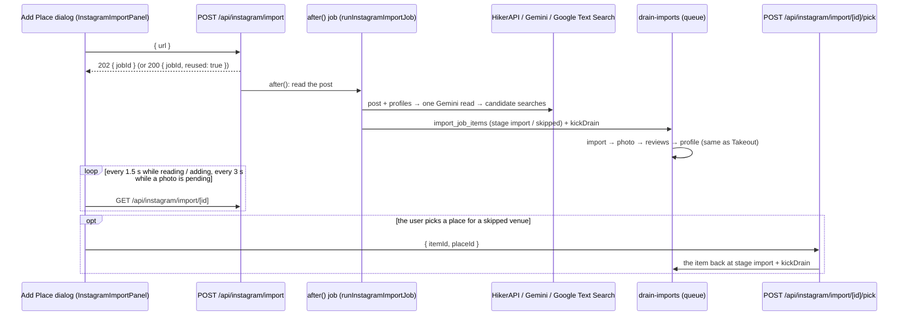

# Instagram Import Flow

A user shares an Instagram post or reel; every venue the post features that can
be pinned **on evidence** lands on their map — no confirmation step. The server
reads the post, decides deterministically which Google place each venue is, and
hands the new places to the same durable queue that runs Takeout imports, so
they get the full photo → reviews → AI-profile enrichment. Venues that cannot be
pinned are listed with the reason. When Google returned places a venue could be
(a chain's branches, near-matches), the user picks one in the dialog and it is
added the same way; otherwise a one-tap hand-off to the map search, aimed at
where the post puts the venue.

**End state.** New places: `source = 'instagram'`, visit status `want_to_go`,
the user's `instagram` tag, the canonical post URL as the note. Places the user
already had: the tag added and the post URL appended to their notes (once).

> **Deployment state (16.10.2026).** The code is on the `feat/instagram-import`
> branch, not merged. Its DB migration was applied to the live database on
> 16.10.2026 — see [[../02-backend/schema/import-jobs#instagram-migration]].
> `HIKERAPI_KEY` has to be set in the Vercel environment for it to run there.

## Trigger

- **iPhone:** the iOS Shortcut "Add to MapOrganiser" opens
  `/map?add=<url-encoded link>`. `MapContent` opens the Add Place dialog with
  that URL as `initialUrl`; when it is an Instagram post/reel link the dialog
  switches to Instagram mode.
- **Paste on `/map`:** an Instagram post link pasted into the map FAB's Add
  Place dialog does the same.
- **Paste in the header:** the header's Add Place dialog (`AppHeader`, any page)
  does not run the import itself. Its `onInstagramLink` closes the dialog and
  navigates to `/map?add=<canonical post URL>` — keeping the query string (the
  filters) when already on `/map`, minus any `ig` — so an import started there
  runs on the map page with everything the map page adds: progress, `?ig`
  refresh, the map search, Show on map, the background toast.
- **Not** the PWA share sheet: `/api/share-target` only forwards Google Maps
  links (its regex), so an Instagram link shared that way lands on plain `/map`.
  See [[share-target-flow]].

A link counts as a post when `parseInstagramPostUrl` (`src/lib/instagram/url.ts`)
finds `instagram.com/[<user>/](p|reel|reels|tv)/<shortcode>` (www./m. hosts
included) in any whitespace-separated token — share sheets sometimes wrap the
link in text. The result is canonicalised to
`https://www.instagram.com/p/<shortcode>/`, which is what HikerAPI is asked for,
what the job stores in `file_name`, and what becomes the note.

Any other Instagram link — a profile, a story; `isInstagramUrl` matches any
whitespace-separated `http(s)://` token on `instagram.com` or `instagr.am`,
subdomains included — never reaches the Maps parser.
The dialog shows "That's an Instagram profile or page, not a post. Share a post
or reel to add the places in it." under the input (`role="alert"`), whether the
link was pasted or arrived as `initialUrl`, and sends nothing.

## Steps

### A. Dialog

1. `AddPlaceDialog` sees an Instagram post URL — in `initialUrl` or via
   `handlePaste` — and renders [[../03-frontend/components/places#instagramimportpanel|`InstagramImportPanel`]]
   instead of the parse-link preview (the header's dialog hands the link over
   instead — Trigger). `parse-link` is never called for it.
2. The panel starts the job once per URL through
   [[../03-frontend/hooks/use-instagram-import|`useStartInstagramImport`]]
   (`POST /api/instagram/import`; a ref guards React's development double
   mount). On `/map` the returned id goes up to `MapContent`, which writes
   `?ig=<jobId>` into the URL with `router.replace`, keeping every other param
   (the filters). The id is reported from the mutation's own `onSuccess`, not
   from `mutate()`'s callbacks, which TanStack drops once the panel unmounts — so
   it still arrives when the dialog was closed before the server answered. In
   that case `MapContent` (`handleInstagramJob`) has no dialog to show it in and
   watches the job in the background instead (step 26).

### B. Request — `POST /api/instagram/import`

3. Gates, in order: session (401) → body `{ url }` (Zod, 400) → it is an
   Instagram post link (400) → `HIKERAPI_KEY` and `GOOGLE_GENERATIVE_AI_API_KEY`
   set (503) → the user has a Google Places key via `getUserApiKeys` — their own
   key, or `GOOGLE_PLACES_API_KEY` for admins (400 "Instagram import needs a
   Google Places API key. Add one in Settings.").
4. **Reuse.** The user's newest `kind = 'instagram'` job for the same canonical
   URL, created in the last 10 minutes and whose stored phase is not `failed`,
   is returned as `200 { jobId, reused: true }`. The iOS Shortcut can fire twice.
5. `ensureInstagramTag` finds the user's `instagram` tag (any letter case) or
   creates it with colour `#E4405F`; a lost race with a parallel import falls
   back to the row the unique `(user_id, name)` index kept.
6. Insert the job on the session client: `kind 'instagram'`, `file_name` = the
   canonical URL, `total 0`, **`status 'reading'`**, `visit_status 'want_to_go'`,
   `tag_ids [tagId]`, `meta { phase: 'reading', shortcode }`. `reading` rather
   than `running` because the drain's `finalizeJobs` closes any `running` job
   that holds no active items — and this one has none until the post is read.
7. Answer `202 { jobId }`; `after()` then runs `runInstagramImportJob` on the
   service-role client. The route exports `maxDuration = 120`.

### C. Background job — `runInstagramImportJob` (`src/lib/instagram/import-job.ts`)

8. `checkAiBudget("instagram")` — 300 posts per user per calendar month (UTC).
   Over it, the job fails with `budget_exceeded` before any paid call.
9. `analyzeInstagramPost` (`src/lib/instagram/analyze.ts`), detailed in
   [[#how-a-venue-is-pinned]]: HikerAPI → one Gemini read → Google Text Search →
   deterministic rules. It writes nothing.
10. Usage: each HikerAPI request → `hikerapi_request`, each Text Search →
    `text_search_enterprise` (both in a `finally`, so a failed analysis is still
    counted), then one `ai_instagram_read` once the analysis has succeeded.
11. One `import_job_items` row per decision (service-role insert):

    | Decision | `stage` | `reason` | `place_id` | `payload` |
    |---|---|---|---|---|
    | Pinned, not yet saved | `import` | — | — | `name`, `address`, `lat`, `lng`, `googleMapsUrl` = `https://maps.google.com/?cid=<cid>` (or `?q=place_id:<id>` without a CID), `note` = post URL, `instagram` (below) |
    | Pinned, already saved (`findExisting` by place_id / CID) | `skipped` | `Already exists` | the existing place | same as above; `attachInstagramSource` has already added the tag + note |
    | Not pinned: `chain_branch_unknown`, `no_evidence`, `ambiguous`, `closed` | `skipped` | the code | — | `name`, `instagram` (with `options` and `near`) |
    | `not_a_venue`, `not_featured`, `unverified_name` | not written | | | |

    `payload.instagram` (`InstagramItemInfo`): the candidate label, its sources,
    the rule that accepted it, human evidence labels ("Tagged in photo",
    "Phone matches", "Location matches", "Only one nearby", …), the skip code,
    how many same-name places were seen, and `searchName` — the prefill for the
    map search. A venue that was not pinned also stores:
    - `options` — the places it could be, at most 20, each
      `{ id, name, address, lat, lng, cid }` (which ones and in what order:
      [[#7-options-for-a-skipped-venue]]); a candidate without a CID is left
      out, because the queue resolves a place by CID;
    - `near` — where the post puts the venue: the area's centre, else the
      profile's coordinates, else the location tag's pin; `null` when none is
      known;
    - `searchName` = the name at least two options share — "Caffè Nero" rather
      than the account's "Caffè Nero Türkiye" — else the display name.
12. Close the reading phase: `meta = { phase: 'adding' | 'done', shortcode,
    post: { owner, ownerFullName, caption (≤ 280 chars), locationName } }`,
    `total` = new + already-saved places, `status 'running'` when there is
    something to import (then `kickDrain`), else `status 'done'` + `finished_at`.
13. Any throw → `meta = { phase: 'failed', shortcode, error }`, `status 'done'`;
    `error` is `invalid_url`, `post_unavailable`, `not_configured` or
    `service_error`.

### D. Queue — `GET /api/cron/drain-imports`

14. The `import` stage runs `importPlace` exactly as for a Takeout row, with the
    job's defaults: visit status `want_to_go`, the `instagram` tag, and
    `source: "instagram"` because the job's `kind` is `instagram`. The
    `?cid=` URL resolves to a `cid:` DataForSEO business-info lookup; the place is
    inserted under Google's display name with the post URL as `notes`.
15. `photo` → `reviews` → `profile` follow as for any import — see
    [[place-import-flow]] and [[ai-enrichment-flow]].
16. If the place appeared between the analysis and the drain, `importPlace`
    returns `skipped / Already exists`; the drain then runs
    `attachInstagramSource` on the existing row itself.

### E. Progress and result

17. [[../03-frontend/hooks/use-instagram-import|`useInstagramImport`]] polls
    `GET /api/instagram/import/[id]` every 1.5 s while the phase is `reading` or
    `adding` (or nothing has loaded yet), then every 3 s while any item's photo
    is still pending — the new places' pictures land a stage later. The map
    page's background watcher stops at the first part (`waitForPhotos: false`).
18. The route computes what the dialog shows. The drain's `finalizeJobs` writes
    `meta.phase = 'done'` when it closes the job and a pick writes `adding`, but
    the phase shown is derived:
    - stored `reading` older than 3 min → `failed` / `stalled` (the background run
      was lost);
    - stored `adding` or `done` → `adding` while any item is still at stage
      `import`, else `done`.
    - Items: `import` → `pending`; `photo`/`reviews`/`profile`/`done` → `added`
      (`removed` when its place has since been deleted); `skipped` +
      `Already exists` → `already_saved`; `failed` → `failed`; other `skipped` →
      `skipped`.
    - Each item also carries `options` (skipped items only, without the CID),
      `near`, and `photoPending`: at stage `photo` and an `updated_at` — which the
      drain stamps on every stage change — under 10 minutes old
      (`PHOTO_WAIT_MS`), so a photo that never comes stops counting as pending
      and the polling ends.
19. The panel invalidates `["places"]` as items land, so pins appear during the
    run. Finished, it shows a single-place card (a spinner where the photo goes
    while `photoPending`) or a list. Each added place has **Remove**
    (`DELETE /api/places/[id]` — deletes the place). A skipped venue with options
    has **Pick branch** (`chain_branch_unknown`) or **Choose** (any other reason),
    which opens the picker (section F); one without options has **Search**, on `/map`
    only (step 29).

### F. Picking a place for a skipped venue

20. **Pick branch** / **Choose** turns the dialog body into the picker: title
    "Which <name>?" (for a chain, the shared `searchName`: "Which Caffè Nero?"),
    description "N branches · pick the one in the post" ("N places" for the
    other reasons; a single option reads "Is this <name>?" / "One match on
    Google · tap it if it's the place in the post"), one row per option with
    its name and address, and
    a filter box from 7 options ("Filter by street or district" — a
    Turkish-aware match on name and address, `fold`). Footer: **Back** to the
    list and, on `/map`, **Search the map** (step 29). On each switch the focus
    moves to the dialog title before the view changes (the button that had it
    unmounts, and the dialog would otherwise keep focus on itself) and the body
    scrolls back to the top, so the filter box is in view.
21. Tapping a row calls [[../03-frontend/hooks/use-instagram-import|`usePickInstagramPlace`]]
    → `POST /api/instagram/import/[id]/pick { itemId, placeId }`. Every row is
    disabled and the tapped one spins until the answer.
22. The route reads the job (`kind = 'instagram'`, the user's own) and the item
    (in that job) on the session client, so RLS proves both are the user's. It
    answers 409 "This place can't be picked for that item." unless the item is
    still `skipped`, is not `Already exists`, and `placeId` is one of its stored
    options — only a place the import itself offered can be picked. The lookup
    and writes below run on the service role (`import_job_items` has no UPDATE
    policy).
23. **Already saved** (`findExisting` by place id / CID finds it):
    `attachInstagramSource` adds the job's tag and the post link to that place;
    the item becomes `skipped` / `Already exists` with its `place_id`; the job's
    `total` grows by one; the answer is `{ status: "already_saved" }` and the
    panel toasts "<name> is already in your places · tag and link added".
24. **Otherwise** the item goes back into the queue: `stage 'import'`,
    `attempts 0`, `claimed_at null`, and a payload built from the option —
    `name`, `address`, `lat`, `lng`, `googleMapsUrl` =
    `https://maps.google.com/?cid=<cid>`, `note` = the post URL, and `instagram`
    with `rule 'picked'`, `evidence ["Picked by you"]`, no skip code and the
    options dropped. The update is guarded by `stage = 'skipped'`, so a double
    tap queues the place once — the second gets 409 "Already picked.". The job
    goes back to `status 'running'` (the claim only reads running jobs),
    `finished_at null`, `meta.phase 'adding'`, `total + 1`; `kickDrain`; the
    answer is `{ status: "pending" }`.
25. The drain adds the place exactly like an automatic one (steps 14–15):
    `want_to_go`, the `instagram` tag, the post link as the note,
    `source 'instagram'`, the full enrichment, and `finalizeJobs` closes the job
    again. The panel is back on the list (the pick invalidates the job's query);
    while only picked places are pending the title reads "Adding <name>…", and
    the row ends as "Picked by you · <address>".

### G. Leaving and coming back (map page)

26. **Close mid-way** ("Continue in background" or ✕) → `closeAddDialog` drops
    `?ig`; if the last phase seen was not `done`/`failed`, `MapContent` keeps
    polling that job in the background and toasts once when it ends —
    "N places added from Instagram", "No new places from that Instagram post" or
    "Couldn't add from that Instagram post" — with a **View** action that
    reopens the dialog on the job; the toast stays 10 s. A job whose id arrives
    after the dialog closed (step 2) is watched the same way.
27. **Refresh** with `?ig=<jobId>` → `MapContent` reopens the dialog in
    Instagram mode for that job; no post URL is needed.
28. **Show on map** → the dialog closes and `MapView.fitToCoords` frames every
    added and already-saved place (one place: fly to zoom 16; several: fit bounds,
    padding 80, max zoom 15).
29. **Search** / **Search the map** → the dialog closes and
    `SearchBoxHandle.search(name, { proximity })` puts the venue name (its
    `searchName`) in the box with the suggestions open. The point is the
    venue's `near`, else the centre of its options, else the centre of the
    places this post already put on the map (added or already saved); when there
    is one, the map flies there (zoom 12) and the suggestions stay inside a box of
    about 30 km around it until the box is cleared or a result is picked — a
    proximity bias alone still put Indonesian archives first for "Westminster
    Libraries and Archives" with London as the point. Without one — and always for
    **Search manually**, which an empty result offers — the search keeps the
    viewport bias. The result panel starts with the post link as the note and
    the `instagram` tag (`SearchResultPanel` `prefill`). The user continues in
    [[place-search-flow]].

Steps 26–29 exist only on `/map`, which is why the header hands a pasted post
link to `/map?add=` (Trigger). `SimilarPlaces`' dialog still runs an import in
place: it reports in the dialog and the picker works, but there is no `?ig`, no
completion toast after closing, no Show on map and no map search.

## How a venue is pinned

### 1. Read the post (HikerAPI)

`getMediaByUrl` for the post, plus `getMediaUsertags` for a reel whose v1 answer
carried no usertags. Accounts = tagged (photo and every carousel slide) ∪
coauthors ∪ caption @mentions ∪ **the owner, always** — on a venue's own post,
the owner's profile carries the phone, website or coordinates that pin it. One
profile read per account, five in parallel. See [[../04-integrations/hikerapi]].

### 2. Classify (one Gemini call)

`readPost` (`src/lib/instagram/read-post.ts`): `gemini-3-flash-preview`,
`Output.object(PostReadingSchema)`, `thinkingLevel: "low"`; the prompt carries the
caption (≤ 3,000 chars), the location tag, the owner and each account with its
profile (bio ≤ 200 chars). The system prompt states that precision matters more
than recall and defines "featured" (shown or recommended as a place to go — not
tour stops, sub-spaces of another featured venue, orientation landmarks or
credited accounts).

Per account it returns a `role` — `venue`, `venue_brand_multi` (a brand running
several locations), `person`, `media_or_creator`, `brand_or_product`, `other` —
plus `featured`, `branch_hint`, `address_in_post`, `venue_name` and a short
evidence quote. For the post: `location_tag_is_specific_venue`, `text_venues`
(venues named in the caption without an account) and `area` {neighbourhood,
district, city, country}. **The model never chooses a Google place.**

### 3. Verify the model's quotes

Nothing the model returns is trusted unless the post says it
(`analyze.ts`, `quoted` / `verified` / `fromPost`):

- a branch hint, area or city counts only if its words occur in the post text
  (caption + location tag + bios) or inside one of the post's usernames;
- an address only if at least 80 % of its words occur;
- a plain-text venue only if its name is in the caption itself
  (`unverified_name` otherwise);
- an area may vouch for "only one nearby" (`fromPost`) only when it is written in
  the caption, the location tag or a username — **never only in a bio**, because
  bios name a brand's home branch.

### 4. Build candidates

- Each account the model calls `venue` / `venue_brand_multi` and featured
  (others are dropped as `not_a_venue` / `not_featured`; a non-venue owner is
  dropped silently).
- The location tag, when the model says it names one specific venue: merged into
  the account candidate it matches (name ≥ 0.6, or within 150 m), else its own
  candidate.
- Each verified plain-text venue: merged into a matching candidate
  (name ≥ 0.7), lending it the post's address and area; otherwise its own
  candidate if the model marked it featured (`not_featured` if not).
- **Area:** the verified hints (branch hint → neighbourhood → district) are
  geocoded with one Text Search each, in that order, until one comes back as an
  area: the top hit must not be an establishment and must carry an area type —
  radius 2 km (neighbourhood), 2–2.5 km (sublocality, colloquial area), 1.5 km
  (route), 2.5–7 km (admin levels 4–2).
- **The venue's own Maps link** in its profile website or bio (`maps.app.goo.gl`,
  `goo.gl/maps`, `g.page`, `google.*/maps`, `maps.google.*`) is followed once
  (plain fetch, redirects) to read its CID, place id, name and coordinates
  (`src/lib/instagram/maps-link.ts`).

### 5. Search Google

`searchPlaceCandidates` (`src/lib/google/place-candidates.ts`) — Places API (New)
Text Search with an **Enterprise** field mask (`websiteUri` and the phone fields
are the evidence), 5 results per query (20 for the city-wide one), a location-bias
circle whenever a coordinate is known. `resolveCandidate` tries the candidate's
queries in order — Maps-link name near its pin, the post's address, name near the
profile / tag / area coordinates, name + profile address, name + branch hint, the
city-wide query, alternative names — and stops as soon as a place is decided,
except that a `unique_in_area` decision waits until every remaining query,
the city-wide one included, has run.

### 6. Decide — `src/lib/instagram/resolve.ts`

Evidence per Google candidate (`evidenceFor`): same phone (last 9 digits); same
website (registrable domain; link-in-bio hubs such as linktr.ee or wa.me never
count); Google's website is the account's own Instagram URL; the venue's Maps link
names this CID / place id; street address match (same house number and a shared
street word) against the profile/tag address or the post's quoted address; the
verified branch hint inside Google's address; distance from the profile
coordinates and from the location tag; inside the area; name similarity 0–1
(Turkish-aware, generic words like "cafe" or "istanbul" ignored); permanently
closed.

| Group | Means | Signals |
|---|---|---|
| pin | names the exact spot | Maps link, address match, post address match, branch hint |
| location | puts it at this spot | pin, or ≤ 100 m from the profile coordinates, or ≤ 120 m from the location tag |
| identity | it is this business — but every branch of a chain shares it | phone, website, Instagram handle, Maps link |

| Candidate | Accepted by | When |
|---|---|---|
| account, single venue | `evidence` | name ≥ 0.5 **and** identity or location evidence |
| account, `venue_brand_multi` | `evidence` | name ≥ 0.5 **and** location evidence — identity alone is not enough for a chain |
| account | `near` | name ≥ 0.85 and ≤ 300 m from the profile coordinates or the location tag |
| account (not a chain), plain-text venue | `unique_in_area` | the area is from the post itself (not only a bio), name ≥ 0.9, inside the area, a distinctive name (≥ 5 characters once spaces are removed), no same-name place elsewhere (> 150 m away and a different address) — decided only after the city-wide query |
| location tag | `location_tag` | name ≥ 0.6 and ≤ 150 m from the tag, or an address match |
| plain-text venue | `post_address` | name ≥ 0.6 and the post's own address matches |

When several places pass: keep those with pin evidence, then those with location
evidence; **duplicate Google listings** (all names ≥ 0.95 within 60 m) → the most
rated, if it has at least 3× the runner-up's ratings; **sub-venues of one
building** (within 150 m or the same address) → the best-named one, if it leads
by ≥ 0.095. Still several → skip as `ambiguous` (`chain_branch_unknown` for a
chain). An account accepted without location evidence that has a same-name place
elsewhere → `chain_branch_unknown`. A permanently closed pick → `closed`.
Nothing accepted → `no_evidence` (`chain_branch_unknown` for a chain).

Finally, one decision per Google place: a second candidate that resolves to the
same place only adds its sources.

### 7. Options for a skipped venue

When no place is decided, `optionsFor` (`resolve.ts`) keeps what the searches
already returned for the user to pick from — no extra request:

- every place the candidate's queries found that is an establishment or point
  of interest, has a CID and is not permanently closed;
- of those, the ones named like the venue (name ≥ 0.6) or sharing its identity —
  phone, website, Instagram handle, the Maps link's CID / place id;
- when none qualify (a library service whose branches each carry their own
  name), the places returned by the queries that did not carry an address — the
  profile's / location tag's or the post's; a brand's profile address is usually
  its head office;
- nearest first to the candidate's area or, without one, its profile
  coordinates; otherwise in the order the searches first returned them; at most
  20 (`MAX_OPTIONS`).

`near` (step 11) comes from the same candidate: the area's centre, else the
profile coordinates, else the location tag's pin.

## Inputs / outputs

| Step | Input | Output |
|---|---|---|
| B | `{ url }` | 1 `import_jobs` row (`kind 'instagram'`, `status 'reading'`), the `instagram` tag if new |
| C | the post URL | `import_job_items` rows; `meta.post`; tag + note on already-saved places; `api_usage` rows (`hikerapi_request`, `text_search_enterprise`, `ai_instagram_read`) |
| D | `import` items | `places` rows (`source 'instagram'`) + `place_tags`, then photo, reviews, profile |
| E | job id | `InstagramImportView` — phase, error, post summary, item views with place coordinates and photo, `options`, `near`, `photoPending` |
| F | `{ itemId, placeId }` | the item back at stage `import` and the job `running` again — or, for a place the user already has, the item `skipped / Already exists` and the tag + note on that place |

## Measured quality

Regression set `scripts/instagram-eval/labels.json` — 35 hand-labelled public
posts: 25 the rules were tuned on (`dev`, 34 venues to add) and 10 never seen
while tuning (`holdout`, 9 venues to add). `npm run eval:instagram` runs the
production analyzer and writes nothing to the database; it exits 1 on any wrong
or spurious place. Measured 16.10.2026 with 3 independent Gemini samples:

- **Prototype (rules frozen, before the port):** 0 wrong places in all three
  samples; recall 85–88 % on `dev`, 7 / 9 on `holdout`.
- **Production code (`npm run eval:instagram`, three full runs):** **0 wrong or
  spurious places** in every run; recall **37–38 / 43 (86–88 %)** — `dev`
  29–30 / 34, `holdout` 8 / 9. Reading the owner's profile on every post fixed
  the venue's-own-post miss (Barcelona Tapas, `holdout`).
- Per post: ≈ 4 HikerAPI requests (the owner profile is the extra one),
  ≈ 3 Google Text Searches, 1 Gemini call.

Remaining misses, by reason (the runner prints them):

- chain branches that only the photos identify (`chain_branch_unknown`) — 3 in
  the study-café list;
- Walter's Coffee: the only area hint is the brand's bio ("Moda") while the post
  shows its other branch — skipped (`no_evidence`), which is the right outcome;
- a café inside a cultural complex: the model marks the café not featured and
  the complex (a location tag) is added instead — labelled `optional`;
- run-to-run: one list venue occasionally drops out of a run (Gemini variance);
  each was added in the other runs and in isolated re-runs.

## Cost per post

| Call | Count | SKU | Price |
|---|---|---|---|
| HikerAPI | ≈ 4 | `hikerapi_request` | $1 / 1,000 |
| Google Text Search (Enterprise) | ≈ 3 | `text_search_enterprise` | $35 / 1,000 after 1,000 free a month — on the user's Google key |
| Gemini read | 1 | `ai_instagram_read` | $1.5 / 1,000 (≈ 1.2k in / 0.3k out tokens) |
| DataForSEO + profile, per place added | as for any import | see [[place-import-flow]] | |

The monthly `instagram` budget (300 posts per user) bounds the first three.

## Failure modes

| Where | Symptom | Cause / behaviour |
|---|---|---|
| A | "That's an Instagram profile or page, not a post. Share a post or reel to add the places in it." under the input | An Instagram link that is not a post or reel (`isInstagramUrl` without `parseInstagramPostUrl`). Nothing is sent. |
| B | 400 "That isn't an Instagram post or reel link." | A non-post URL sent to the route directly — the dialog stops those first (row above). |
| B | 503 "Instagram import isn't set up on this server." | `HIKERAPI_KEY` or `GOOGLE_GENERATIVE_AI_API_KEY` missing. |
| B | 400 "Instagram import reads the post with AI. Turn on AI features in Settings." | `profiles.ai_features_enabled` is off. |
| B | 400 "…needs a Google Places API key. Add one in Settings." | No per-user key and not an admin. The `google_places_enabled` toggle (it scopes Maps-link lookups) is deliberately not consulted — see Decisions. |
| B | 500 with the database error text | The tag or the job insert failed. |
| C | "You've used this month's Instagram imports." | `budget_exceeded`; no Try again. |
| C | "Couldn't open this post. It may be private or deleted." | `post_unavailable` (HikerAPI 404). |
| C | "Something went wrong while reading this post." | `service_error`: HikerAPI still failing after its retries, a Google Text Search failing twice, the Gemini call failing, or the item insert failing. Try again starts a new job. |
| C | "This took too long and stopped." | `stalled`: still `reading` after 3 min — the `after()` run died (e.g. hit `maxDuration`). Try again starts a new job (the reuse check skips stalled jobs). |
| C | "No places in this post" | Nothing could be pinned and no skipped venue is listed: the dialog says no account, location tag or address points to one specific place; on `/map`, "Search manually" opens the map search. |
| C | "Nothing added yet" | Every venue was skipped; the rows below offer **Pick branch** / **Choose** / **Search**. |
| C | "<name> removed" | The user removed the only place the import added: "Nothing from this post is on your map now. If it was the wrong match, search for the right place."; **Search manually** starts with that name. |
| D | An item ends `failed` | As in [[place-import-flow]] — DataForSEO / insert errors, 3 failed attempts. |
| D | Items stay "Adding…" | The drain never runs: `CRON_SECRET` unset (the kick no-ops; locally there is no cron at all) or no DataForSEO credentials. |
| E | "Couldn't load this import." | `GET` 404 (not this user's job, or not an Instagram job). The hook keeps polling while the dialog is open. |
| F | Toast "This place can't be picked for that item." (409) | The item is no longer a skipped venue (it was added, or is `Already exists`), or the place is not one of the options stored for it. |
| F | Toast "Already picked." (409) | Another tap or tab queued the item first; the guarded update matched nothing. |
| F | Toast "Not found" (404) | The job is not this user's Instagram job, or the item is not in it. |

## Known limits

- **Chains pinned only by photos** are skipped as `chain_branch_unknown`, with
  "N branches · the post doesn't say which" and **Pick branch**. The picker
  lists only what the import's searches returned (at most 20); a branch outside
  that set is reached through **Search the map**.
- **A place picked in the dialog** goes through the queue like an automatic one
  (`source 'instagram'`, evidence "Picked by you"). **A place found through
  Search** is saved by the normal search flow (`source 'mapbox_search'`); its
  form starts with the post link as the note and the `instagram` tag selected
  (`SearchResultPanel` `prefill`), both editable.
- **Testing on a preview deployment.** The drain kick cannot pass Vercel
  Deployment Protection there, so the items a preview creates — a pick included
  — are drained by production's minute cron, i.e. `main`'s code, which has no
  Instagram handling yet (it inserts them as `source 'import'`). The owner
  decided to verify the drain after the merge.
- **Gemini output varies between runs.** The precision guard held in every run;
  recall moves by about one place.
- **Telemetry.** The read emits `ai.instagram-read-post` spans
  (`experimental_telemetry`, userId + shortcode); the `after()` run ends with
  `flushLangfuse` like the other LLM routes — see [[observability-flow]].
- **A profile read that fails** is retried once and logged
  (`[instagram] profile @… failed`); a missing profile only weakens the evidence.

## Related code

- `src/lib/instagram/url.ts` — `parseInstagramPostUrl`, `isInstagramUrl` (client-safe).
- `src/lib/instagram/types.ts` — job meta, item info (incl. `InstagramPlaceOption`) and the dialog's view shapes (client-safe).
- `src/app/api/instagram/import/route.ts` — create / reuse a job, `after()`.
- `src/app/api/instagram/import/[id]/route.ts` — the dialog's progress view.
- `src/app/api/instagram/import/[id]/pick/route.ts` — add the place picked for a skipped venue.
- `src/lib/instagram/import-job.ts` — `runInstagramImportJob`: budget, usage, item rows (options, `near`, `searchName`), finish.
- `src/lib/instagram/analyze.ts` — `analyzeInstagramPost`: accounts, verification, candidates, area, `near`.
- `src/lib/instagram/read-post.ts` — the Gemini read and `PostReadingSchema`.
- `src/lib/instagram/resolve.ts` — evidence, acceptance rules, tie-breaks, query plan, `optionsFor`.
- `src/lib/instagram/normalize.ts` — Turkish-aware name, phone, website, address and distance helpers.
- `src/lib/instagram/maps-link.ts` — find and follow a venue's own Maps link.
- `src/lib/instagram/provenance.ts` — `ensureInstagramTag`, `attachInstagramSource`.
- `src/lib/hikerapi/client.ts` — see [[../04-integrations/hikerapi]].
- `src/lib/google/place-candidates.ts` — Text Search (Enterprise field mask).
- `src/lib/import/kick-drain.ts` — shared with the Takeout import.
- `src/app/api/cron/drain-imports/route.ts`, `src/lib/import/process-place.ts` — the queue.
- `src/lib/hooks/use-instagram-import.ts` — start, poll, pick.
- `src/components/places/instagram-import-panel.tsx` (incl. the picker), `src/components/places/add-place-dialog.tsx` — the UI.
- `src/components/layout/app-header.tsx` — hands a pasted post link to `/map?add=`.
- `src/components/map/map-content.tsx` — `?add=`, `?ig`, background watcher, toasts, hand-offs; `map-view.tsx#fitToCoords`; `search-box.tsx#SearchBoxHandle`.
- `scripts/instagram-eval/` — `run.ts`, `labels.json`, `README.md`, `tsconfig.json`.

## Decisions

- **Google Places for the candidate search, whatever the toggle says** (owner,
  16.10.2026). The import uses Google Text Search even when the user's
  `google_places_enabled` toggle ("Use Google for fast place lookup when adding
  links") is off: the toggle keeps scoping Maps-link lookups, and the evidence
  rules were built and measured on Google results. Another path (e.g. a
  DataForSEO candidate search) is to be considered only if cost or the toggle's
  meaning calls for it.
- **Entry points** (owner, 16.10.2026): the iOS Shortcut and pasting a link.
  `/api/share-target` keeps forwarding only Google Maps links.
- **Pick branch lists Google's candidates in the dialog; the map search is the
  fallback** (16.10.2026). The options are what the import's own searches
  returned, so picking costs no extra search and the place is added through the
  queue like an automatic one; a venue with no options, or a branch the searches
  did not return, goes to the map search aimed at the post's area.

## Open questions

- None at the moment.
